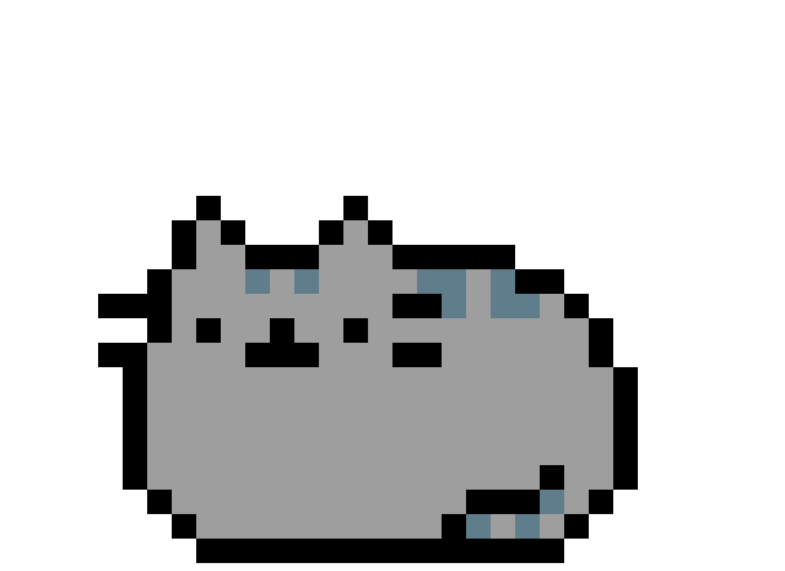

<h1 align="center">Hi there 👋, I'm Yadu</h1>

  I'm a data engineer who likes making messy data behave.  
  Most days you'll find me wrangling Spark jobs, designing lakehouses, or tinkering with GenAI on top of all that data.

  
  

---

## 🛠️ Tech Stack

**Languages**

**Data Engineering & Platforms**

**AI & Retrieval**

**DevOps & Tools**

---

## 📊 GitHub Stats 

  

  

  <picture>
    <source media="(prefers-color-scheme: dark)" srcset="https://raw.githubusercontent.com/Yadu9238/Yadu9238/output/github-snake-dark.svg" />
    <source media="(prefers-color-scheme: light)" srcset="https://raw.githubusercontent.com/Yadu9238/Yadu9238/output/github-snake.svg" />
    
  </picture>

---

## 📸 Beyond Data

📷 Photography &nbsp;·&nbsp; 🎮 Video Games &nbsp;·&nbsp; 🏎️ F1 &nbsp;·&nbsp; 📚 Manga

---

  <i>Thanks for stopping by! Feel free to connect or reach out to me. 🚀</i>

